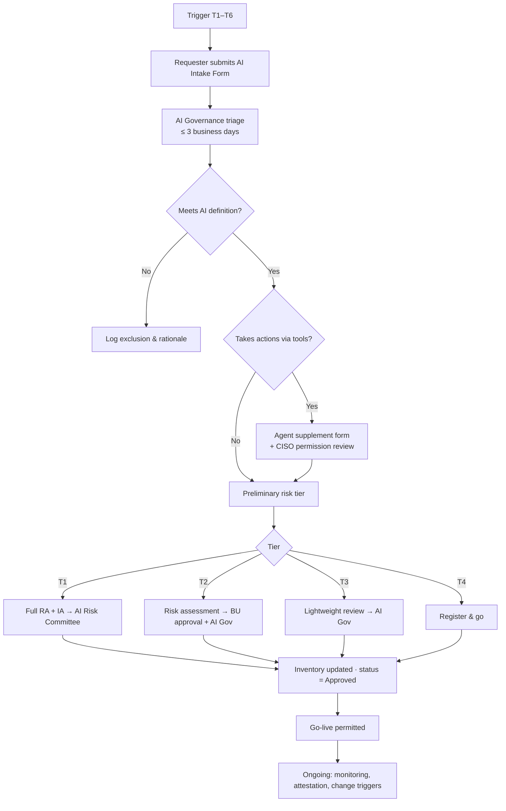

# AI Intake & Inventory Maintenance Process
**Vantage Point Insurance** · Document ID: VPI-AIG-PRO-001 · Version 1.0 · Classification: Internal
**Process owner:** Head of AI Governance · **Effective:** 2026-08-01 · **Review:** Annually or on material change

---

## 1. Purpose

An inventory that is accurate on the day it is published decays within months. This process keeps the **AI Use-Case Inventory** and **AI Agent Inventory** current by making registration a **gate** in existing workflows rather than a voluntary activity.

## 2. Triggers — When Intake Is Required

| # | Trigger | Detected by |
|---|---|---|
| T1 | New AI use case proposed (build or buy) | Project intake / demand management |
| T2 | Procurement of any software or service with AI functionality | Procurement questionnaire (AI screening question) |
| T3 | Vendor enables a new AI feature in an existing product | IT change management — release-note review |
| T4 | Material change to an existing system: new data source, new population, new decision use, model retrain with new features, autonomy increase, new tool for an agent | Model owner / change request |
| T5 | System discovered via shadow-AI discovery | Quarterly discovery run |
| T6 | Retirement or decommissioning | Model owner |

## 3. Process Flow

## 4. Intake Form — Required Fields

**Core (all systems):** name, business purpose, business owner, technical owner, build/buy/embedded, vendor, data categories, affected parties, users, decision impact, consumer-impacting (Y/N), deployment date, intended lifecycle.

**Agent supplement (if the system can call tools or APIs):** tool list, action permissions per system, service identity, requested autonomy level (A0–A4), approval gates, hard limits, kill-switch design, logging design, untrusted-input sources.

## 5. Service Levels

| Tier | Triage | Assessment & decision | Approver |
|---|---|---|---|
| T1 | 3 days | ≤ 30 business days | AI Risk Committee |
| T2 | 3 days | ≤ 15 business days | BU executive + Head of AI Governance |
| T3 | 3 days | ≤ 5 business days | Head of AI Governance |
| T4 | 3 days | Same week | AI Governance Analyst |

## 6. RACI

| Activity | Requester / BU | Model owner | AI Governance | CISO / Security | Procurement | Legal & Compliance | AI Risk Committee |
|---|---|---|---|---|---|---|---|
| Submit intake | **R** | C | I | — | C | — | — |
| Triage & tiering | C | C | **A/R** | C | — | C | I |
| Agent permission review | I | C | A | **R** | — | — | I |
| Vendor due diligence | C | — | C | R | **A/R** | R | — |
| T1 approval | I | C | R | C | — | C | **A** |
| Maintain register entry | — | **R** | A | — | — | — | I |
| Quarterly attestation | — | **R** | A | — | — | — | I |
| Shadow-AI discovery | — | — | **A** | R | R | — | I |
| Retirement | C | **R** | A | C | C | — | I |

## 7. Enforcement Hooks (Making the Gate Real)

| Control point | Hook |
|---|---|
| Procurement | PO cannot be raised for software flagged "contains AI" without an Inventory ID |
| P-card | AI-vendor merchant alert routed to AI Governance |
| IT change management | Change requests for AI systems require Inventory ID; release-note AI review is a CAB checklist item |
| Production deployment | CI/CD pipeline checks model registry tag `inventory_id` and approval status before promotion |
| Identity | Service identities for agents provisioned only against an approved AG-### record |
| Model risk management | Model validation cannot be scheduled without Inventory ID |

## 8. Ongoing Maintenance

| Activity | Frequency | Output |
|---|---|---|
| Owner attestation of every entry (still accurate, still in use, no material change) | Quarterly | Attestation record; unattested entries escalated after 15 days |
| Agent entitlement & kill-switch review | Monthly (T1) / Quarterly | Permission review evidence; kill-switch test log |
| Shadow-AI discovery re-run | Quarterly | Updated Discovery Log |
| Inventory quality metrics to AI Risk Committee | Quarterly | Dashboard |
| Process review | Annual | Updated procedure |

## 9. Key Metrics

| KPI | Target |
|---|---|
| % of AI systems with Inventory ID before go-live | 100% |
| % of entries attested in last quarter | ≥ 95% |
| New systems found by discovery that bypassed intake | Trending to 0 |
| Median T2 intake cycle time | ≤ 15 business days |
| T1/A3 agents with kill switch tested in last quarter | 100% |

## 10. Exceptions

Emergency deployments (e.g., catastrophe-event claims surge) may go live with Head of AI Governance approval and must complete full intake within **10 business days**. Exceptions are logged and reported to the AI Risk Committee.

## 11. Related Documents

[AI-Use-Case-Inventory.md](AI-Use-Case-Inventory.md) · [AI-Agent-Inventory.md](AI-Agent-Inventory.md) · [Shadow-AI-Discovery-Log.md](Shadow-AI-Discovery-Log.md)
