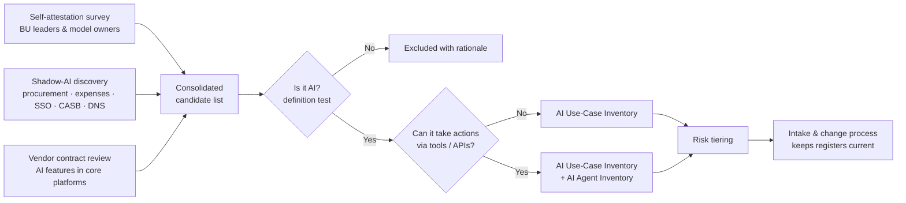

# AI Use-Case Inventory & AI Agent Inventory


### Vantage Point Insurance — Establishing the system of record for every AI system in the enterprise

    

> **Short description:** A discovery-led inventory programme that found **21 AI systems** at a mid-sized insurer — **8 of them unknown to IT** — and separated **6 autonomous / semi-autonomous agents** into a purpose-built agent register that captures tool access, action permissions, autonomy level and kill-switch capability.

---

## 1. Organisation Context

| Attribute | Detail |
|---|---|
| Organisation | Vantage Point Insurance (fictional) |
| Sector | Property & Casualty insurance — personal auto, homeowners, small commercial |
| Size | ~1,850 employees, ~US$1.4bn gross written premium, licensed in 14 US states |
| AI maturity | Fragmented pilots in Underwriting, Claims and Customer Service; no central register |
| Regulatory pressure | NAIC Model Bulletin on the Use of AI Systems by Insurers (adopted by multiple states), Colorado SB21-169 (unfair discrimination testing), state market-conduct examinations |
| Trigger | A state market-conduct exam requested "a list of all AI and predictive models used in claims and underwriting decisions" — the company could not produce one |

## 2. Objective

Build the **authoritative inventory every other governance activity depends on**. Risk assessment, impact assessment, policy enforcement, monitoring and regulator responses all fail if the organisation does not know what AI it runs.

The project deliberately produces **two registers**:

1. **AI Use-Case Inventory** — traditional ML models and AI-enabled features (what the system decides or recommends, about whom, using what data).
2. **AI Agent Inventory** — systems that can *take actions* (call tools, write to systems of record, send communications). These need fields a standard inventory never captures: tool/plugin access, action permissions, autonomy level, human-approval gates and kill-switch capability.

## 3. Scope

**In scope**
- Underwriting, Claims and Customer Service business units
- Internally built models, vendor/SaaS AI features, embedded AI in core platforms, and generative AI tools
- Shadow-AI discovery through procurement, expense, SSO and network-egress data — not self-reporting alone
- Internal risk-tier classification for every entry
- A repeatable intake process that keeps both registers current

**Out of scope**
- Full risk / impact assessments (inventory triggers them; it does not perform them)
- Finance, HR and IT-internal AI use (Phase 2)
- Technical model validation

## 4. Approach



| Phase | Weeks | Activities |
|---|---|---|
| 1. Define | 1 | AI definition, inventory schema, tiering criteria, agent-specific schema |
| 2. Discover | 2–4 | Survey, interviews (22 stakeholders), shadow-AI technical discovery, vendor contract review |
| 3. Validate | 5 | Owner confirmation, de-duplication, definition test, exclusion log |
| 4. Classify | 6 | Risk-tier every entry; agent autonomy levels assigned |
| 5. Operationalise | 7–8 | Intake process, RACI, procurement and change-management hooks, quarterly attestation |

## 5. Deliverables

| # | Deliverable | Purpose |
|---|---|---|
| 1 | [AI-Use-Case-Inventory.md](AI-Use-Case-Inventory.md) | Register of 21 AI use cases with purpose, owner, data, users, decision impact, lifecycle stage, risk tier |
| 2 | [AI-Agent-Inventory.md](AI-Agent-Inventory.md) | Distinct schema for 6 agents: tools, permissions, autonomy level, approval gates, kill switch |
| 3 | [Shadow-AI-Discovery-Log.md](Shadow-AI-Discovery-Log.md) | Discovery method, sources, 8 shadow-AI findings and dispositions |
| 4 | [Intake-Process.md](Intake-Process.md) | Operating procedure that keeps both registers current |

> Registers are maintained as Markdown tables for version control and pull-request review; each table is structured to export directly to CSV/XLSX.

## 6. Key Findings

| Metric | Result |
|---|---|
| AI systems identified | **21** (13 initially self-reported) |
| Discovered only via shadow-AI methods | **8 (38%)** |
| Agents (action-taking systems) | **6**, of which **2** could act without human approval |
| Tier 1 (Critical) systems | **5** — all touch pricing, eligibility, fraud referral or claim payment |
| Agents without a tested kill switch | **3** → remediation tracked |
| Vendor AI features enabled by default, unknown to the business | **2** |

## 7. Framework Alignment

| Framework | Reference | How this project satisfies it |
|---|---|---|
| ISO/IEC 42001:2023 | Cl. 4.3 Scope of the AIMS | Inventory defines which AI systems the AIMS covers |
| ISO/IEC 42001:2023 | Cl. 8.1 Operational planning & control | Intake process controls how AI enters operation |
| ISO/IEC 42001:2023 | Annex A.4 Resources for AI systems (A.4.2–A.4.6) | Data, tooling, compute and human resources documented per system |
| NIST AI RMF 1.0 | GOVERN 1.6 | "Mechanisms are in place to inventory AI systems" — directly evidenced |
| NIST AI RMF 1.0 | MAP 1.1, 1.6, 3.4, 4.1 | Context, requirements, operator proficiency and third-party components captured per entry |
| OWASP Top 10 for LLM Apps (2025) | LLM06 Excessive Agency | Agent schema captures permissions and approval gates to evidence least-agency |
| NAIC AI Model Bulletin | Sec. 3 — AIS Program | Inventory is the foundation of the required written AIS programme |

> **Note on the brief:** the brief referenced ISO/IEC 42001 Clause 8.3. In the published standard, 8.3 is *AI risk treatment*, which **consumes** the inventory. The inventory itself most directly evidences Clause 4.3, Clause 8.1 and Annex A.4 — mapped above for audit accuracy.

## 8. Repository Structure

```
vantage-point-ai-agent-inventory/
├── README.md
├── assets/
│   └── banner.jpg
├── AI-Use-Case-Inventory.md
├── AI-Agent-Inventory.md
├── Shadow-AI-Discovery-Log.md
└── Intake-Process.md
```

## 9. Skills Demonstrated

AI system discovery · Shadow-AI detection (CASB, SSO, procurement analytics) · Inventory schema design · Agentic-AI governance · Risk tiering · Process design & RACI · Insurance regulatory context (NAIC, Colorado SB21-169)

## 10. Disclaimer

Vantage Point Insurance is a fictional organisation. All systems, people, vendors and figures are illustrative and were created to demonstrate professional AI governance practice.

---

